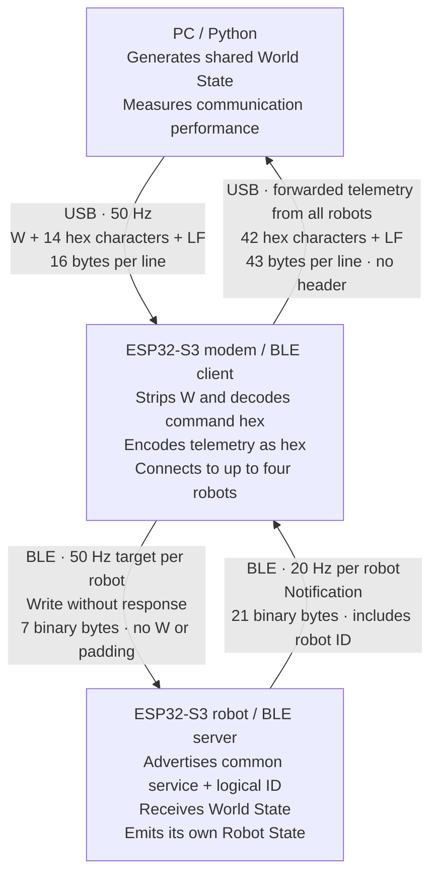

# PC–Modem–Robot Payload Specification

The PC sends one shared **World State** at **50 Hz**. Each of the four cars (mini robots) sends its own **Robot State** at **20 Hz**. The PC sends high-level intent (joystick positions, track topology status); each car performs line following, motor control, NFC-based localization, and intersection execution locally.

At non-regular intervals, PC can send a **Configuration command** to change robot parameters (PID gains, max speed, etc.)

This document specifies the current Test 14 wire format and the intended robot-controller semantics. **Test 14 implements transport only:** movement/topology fields are received but do not drive motors or navigation. NFC, controller state, wheel speed and battery telemetry are synthetic. Configuration commands are a future design, not an implemented feature.

## Transport and Encoding



The robot node represents each of up to four connected robots. All receive the same World State; each returns its own Robot State. Multi-byte integers are little-endian. These packets are latest snapshots, so older snapshots may be discarded. The modem changes only their USB encoding; it adds no BLE headers, session tokens or receive counters. Configuration uses a future separate acknowledged path and is not shown in the current transport diagram.

### BLE discovery and characteristics

All cars share the same UUIDs; identity is independent of their BLE MAC address.

| Item | UUID | Current operation / size |
| --- | --- | --- |
| Service | `12345678-1234-5678-1234-567812345678` | Common car service |
| World State | `12345678-1234-5678-1234-567812345679` | Write without response; exactly 7 bytes |
| Robot State | `12345678-1234-5678-1234-56781234567a` | Notify; exactly 21 bytes |

Primary advertising service data under the common service UUID contains two bytes: `[14, robot_id]`. The first is the Test 14 discovery version, and the second is a logical ID from 1 to 4. These bytes are **advertising metadata**, not part of either characteristic payload. The optional scan-response name is `ble14_car_<id>`; discovery does not depend on the name.

The modem keeps at most one connection per logical ID. When an ID is missing, it periodically scans and can discover a replacement with another MAC address. It retains an existing connection rather than switching to another advertiser with the same ID. Different-MAC replacement is supported by the discovery design but has not yet been tested. Robot State notifications must have the correct length and match the connected peer's logical ID.

The 21-byte notification requires an ATT MTU of at least 24; Test 14 requests 64. The tested modem requests a 20 ms connection interval. Application rates (50 Hz commands and 20 Hz telemetry) are separate from the negotiated BLE interval.

### USB framing and validation

Normal modem application output consists only of Robot State lines. No start, stop, status, acknowledgement or error lines are part of the protocol; the modem starts automatically and continues after the PC logger exits. Debug builds and boot/watchdog output may contain non-packet text, which the PC parser must reject.

Hex digits may be upper- or lowercase; the modem emits lowercase. Lines end with LF (`0x0a`); the modem ignores CR characters, so CRLF input also works. An input line must contain literal uppercase `W` and exactly 14 valid hex digits. Unknown headers (including reserved `C`), invalid hex, incorrect lengths and overflowed lines are silently discarded. A malformed line never replaces the pending World State. There is no application checksum or USB delivery acknowledgement.

USB feedback buffering is bounded. If the PC does not drain output, new notifications can be dropped when the queue fills; this does not block BLE callbacks. Consequently, a PC-observed telemetry gap may arise in the USB path as well as over BLE.

# World State

Sends out at approximately 50Hz
This will "Write without response" to the "world_state" characteristic of each car. All cars will receive the same World State packet.
When a new World State arrives, it replaces the shared unsent snapshot. Each connected car is offered the latest fresh snapshot; delivery is not guaranteed, and writes already submitted to the BLE stack cannot be recalled.
The modem holds one shared pending World State and expires it 1,000 ms after reception. Idle application traffic does not disconnect BLE. The `msg_type` row below describes USB framing only; the remaining rows constitute the seven-byte BLE characteristic.

| Name | Expected format | Bytes | Type | Meaning of that property |
| --- | --- | ---: | --- | --: |
| `msg_type` | `W` | 1 | char | USB-only dispatch character; stripped by the modem before the BLE write. |
| `world_seq` | `0-65535` | 2 | uint16 | Increments per generated World State, normally every 20 ms; wraps from 65535 to 0. Used to observe sequence gaps and correlate telemetry echoes. |
| `topology_id` | `0-255` | 1 | uint8 | ID of the active predefined map/topology configuration. Only a few configurations are possible. |
| `movement_command_1` | bit mask | 1 | bits | Movement Command for Car 1. |
| `movement_command_2` | bit mask | 1 | bits | Movement Command for Car 2. |
| `movement_command_3` | bit mask | 1 | bits | Movement Command for Car 3. |
| `movement_command_4` | bit mask | 1 | bits | Movement Command for Car 4. |

BLE byte offsets are `world_seq` 0–1, `topology_id` 2, and movement commands 3–6. Python packing is `<HB4B` (little-endian, no alignment padding). For example, sequence 4660 (`0x1234`), topology 2, and movements `[1, 3, 5, 0]` encode as:

```text
BLE bytes: 34 12 02 01 03 05 00
USB line:  W34120201030500\n
```

The modem retains up to eight sequence numbers of already-submitted writes per peer, not eight queued payloads. Echoed `last_world_seq` values release these credits. If feedback stops, writes to that peer pause once the credits fill; other peers continue and BLE remains connected. Resuming feedback permits the latest unexpired snapshot to be submitted. The 1,000 ms expiry is measured from modem reception, not PC generation; it is not a car-side motor safety timeout.


## Topology ID

Topology is related to whether some roads or intersections are passible or not due to changing road conditions. Bridge 1 to 4 are movable. At any time, some of the bridges can be missing or under operations. The exact configuration mapping of the `topology_id` is TBD after gameboard design.

The topology is generated by PC, sent and stored locally in every car. PC relies on the latest `world_seq` in received telemetry to confirm that the car received the latest topology before actually removing any bridges.

`topology_id` selects a predefined configuration. The intended controller combines it with its locally detected NFC marker to determine navigation state without an additional communication round trip to the PC. In Test 14, a sequence echo confirms reception of the snapshot, not execution of topology or movement actions.

## Movement Command Encoding

| Bit Position | Name | Meaning |
| --- | --- | --- |
| 0 | `forward` | `1` = FORWARD, `0` = STOP. |
| 1 | `turn_left` | `1` = Left turn at next intersection if possible |
| 2 | `turn_right` | `1` = Right turn at next intersection if possible (takes precedence when both turn bits are set) |
| 3–7 | reserved | Send zero; future semantics are undefined. |

Examples:

- `0` , `2`, `4` = stop
- `1` = forward and continue straight.
- `3` = forward and take the left branch.
- `5` = forward and take the right branch.

STOP takes precedence over the branch command.

Turn signals are indicators for the car controller to make line following decisions at the intersection decision point.

# Configuration Command

**Future proposal; not implemented in Test 14.** Configuration would be sent at irregular intervals through a separate write-with-response path. An ATT write response confirms the GATT write, but does not by itself confirm that the controller applied a configuration. Any application-level `config_ack`, retries and completion rules still need to be specified. Robot State currently contains no configuration acknowledgement field.

| Name | Expected format | Bytes | Type | Meaning of that property |
| --- | --- | ---: | --- | --: |
| `msg_type` | `C` | 1 | char | USB-only dispatch character; stripped by the modem before the BLE write. |
| `world_seq` | `0-65535` | 2 | uint16 | Proposed correlation field; its relationship to World State and retry identity is not yet defined. |

Other configuration parameters are TBD.
Configuration handling is reserved for future implementation; Test 14 implements World State and Robot State only.
Before implementation, define the configuration/ack UUIDs, payload sizes and parameter encoding, target selection (one car or all), correlation and duplicate handling, retry ownership/timeouts, and PC-facing acknowledgement framing. The table above is not a complete interoperable packet format.

# Robot State

Each car sends one Robot State packet at approximately **20 Hz**.

| Name                      | Expected format                     | Bytes | Type   |                                     Meaning of that property |
| --- | --- | ---: | --- | --: |
| `robot_id` | `1-4` | 1 | uint8 | Identifies which car generated this telemetry packet. |
| `telemetry_seq` | `0-65535`                           | 2     | uint16 | Increments for each notification attempt while connected and subscribed; wraps from 65535 to 0. Starts at zero after car reboot; persists across BLE reconnections. A failed notification attempt still consumes a sequence number. |
| `last_world_seq`          | `0-65535`                           | 2     | uint16 | Most recent correctly sized World State received by this car. Zero until the first World State of the current BLE connection. Reception is not confirmation of motor/controller execution. |
| `world_packets_lost_5s` | `0-255` | 1 | uint8 | Number of missing World State sequence numbers detected during the most recently completed five-second measurement window, saturated at 255. The reported value remains fixed until the next five-second window completes. Sequence gaps include intentionally superseded World States and do not identify radio loss alone. |
| `nfc_marker_id` | 6 raw bytes | 6 | bytes | The 2nd to 7th byte of the NFC tag's UID. 1st byte skipped because they are the same. |
| `nfc_marker_age_ms` | `0-65535` | 2 | uint16 | Milliseconds elapsed since the most recent valid NFC marker detection. |
| `controller_follow_state` | `0-10` | 1 | uint8 | Current local intersection/navigation FSM state. |
| `left_speed_mm_s` | signed integer, `-32768` to `32767` | 2 | int16 | Current measured left-wheel speed in mm/s, derived from encoder feedback through the motor driver. Positive and negative signs indicate direction. |
| `right_speed_mm_s` | signed integer, `-32768` to `32767` | 2 | int16 | Current measured right-wheel speed in mm/s, derived from encoder feedback through the motor driver. Positive and negative signs indicate direction. |
| `battery_mv` | `0-65535` | 2 | uint16 | Measured battery voltage in millivolts. Example: `12420` = 12.420 V. |

Python packing is `<BHHB6sHBhhH`, with no alignment padding:

| Byte offset | Field |
| --- | --- |
| 0 | `robot_id` |
| 1–2 | `telemetry_seq` |
| 3–4 | `last_world_seq` |
| 5 | `world_packets_lost_5s` |
| 6–11 | `nfc_marker_id` |
| 12–13 | `nfc_marker_age_ms` |
| 14 | `controller_follow_state` |
| 15–16 | `left_speed_mm_s` |
| 17–18 | `right_speed_mm_s` |
| 19–20 | `battery_mv` |

Test 14 emits NFC ID/age and controller state as zero, both wheel speeds as 150, and battery as 12420. These are test values, not measurements. The future controller still needs definitions for supported NFC UID lengths, marker-age overflow/no-marker behavior, and the meaning of speed/marker values before a measurement is available.

## Controller Follow State

| Code | State | Meaning |
| --- | --- | --- |
| `0` | `FOLLOW_LINE` | Normal line following outside an intersection. |
| `1` | `TURNING_LEFT` | Steep left turn happening |
| `2` | `TURNING_RIGHT` | Steep right turn happening |
| `3` | `APPROACHING_BRANCH` | On top of intersection marker, car is approaching its decision point. |
| `4` | `BRANCHING_CENTER` | Inside branch zone - keep line center |
| `5` | `BRANCHING_LEFT` | Inside branch zone - keep left edge |
| `6` | `BRANCHING_RIGHT`     | Inside branch zone - keep right edge                         |
| `7` | `MERGING_FROM_CENTER` | Inside merging zone - keep line center |
| `8` | `MERGING_FROM_LEFT` | Inside merging zone - keep left edge |
| `9` | `MERGING_FROM_RIGHT` | Inside merging zone - keep right edge |
| `10` | `LINE_LOST` | Line lost and car is unsafe to move |

# Wireless Quality Monitoring

The following are measurement notes, not additional payload fields. Communication performance can be assessed using `world_seq`, `telemetry_seq`, the echoed `last_world_seq`, and local generation/reception timestamps. Sequence numbers identify progression; timestamps provide durations and rates.

Test 14 uses non-overlapping, approximately five-second windows. Car loss windows follow car uptime; PC windows follow logger time, so their boundaries need not align. Other than the existing `world_packets_lost_5s` field, these measurements are computed locally rather than added to Robot State.

## PC to Car : World Packet Loss Count

Each car compares incoming `world_seq` values.

Example:

```text
100 -> 101 -> 104
```

indicates two missing packets: 102 and 103.

The car calculates unsigned 16-bit modular deltas, so 65535 → 0 is contiguous. It counts `delta - 1` only for forward deltas below 32768 and no larger than `elapsed_ms / 20 + 20`. Larger/backward changes are treated as discontinuities rather than thousands of losses; duplicates add no loss. Every correctly sized World State is accepted regardless of sequence direction. The sequence baseline resets on BLE connection, so loss across a disconnected interval is not counted. Window counts saturate at 255 on the wire and initially report zero until a window completes.

## PC to Car : World Silence Duration

At the car, measure time since the last World State reception and the largest interarrival gap in the window using local receive timestamps. Test 14 prints the current receive silence in development serial diagnostics.

At the PC, observe how long the echoed `last_world_seq` fails to advance while new commands are generated. This indicates stalled command progress, but missing telemetry can also prevent the PC from observing progress. It is therefore an estimate, rather than the car's exact receive-silence duration. Application silence does not disconnect BLE.

## Car to PC : Telemetry Packet Loss Count

The PC detects missing Robot State packets by observing gaps in each car's `telemetry_seq`.

The current logger uses modular deltas with a plausibility allowance based on elapsed time and 20 Hz. It records duplicates and discontinuities separately. Without a session token, sequence data alone cannot always distinguish reboot, replacement, rollover or a long outage; zero inferred loss does not prove end-to-end delivery.

## Car to PC : Silence Duration

The PC measures time since its last valid Robot State (`silence_s`) and the largest observed interarrival gap (`max_gap_s`). These include BLE, modem USB buffering and PC scheduling delays; they are not measurements of radio silence alone. A 5-second receive count divided by the actual window duration gives the observed telemetry rate. PC command submissions likewise do not prove car reception.

## Echoed-command age (rough round-trip estimate)

The PC matches `last_world_seq` to the timestamp when it submitted that World State to USB. Age is `notification_arrival_time - command_submission_time`. It includes USB transfer, modem scheduling, BLE write delivery, waiting for the next 20 Hz telemetry notification, and return delivery to the PC. It is not a direct radio RTT or acknowledgement for every command; snapshots may be superseded and multiple notifications may echo the same command.

With a steady 50 Hz generator, `(current_world_seq - last_world_seq) mod 65536 × 20 ms` is a rough alternative, but pauses, bursts and sequence resets invalidate that assumption. The current logger uses recorded submission timestamps instead. World sequence numbers wrap every 1,310.72 seconds at 50 Hz; correlation must not retain ambiguous timestamps across wraps.

Zero is both a valid world sequence and the car's initial/no-world value. There is no validity bit or session token. The logger excludes ambiguous zero echoes at startup or after a suspected reset/outage until it observes a nonzero echo; normal continuous rollover to zero can still be measured. These heuristics reduce false ages but cannot establish session identity.
