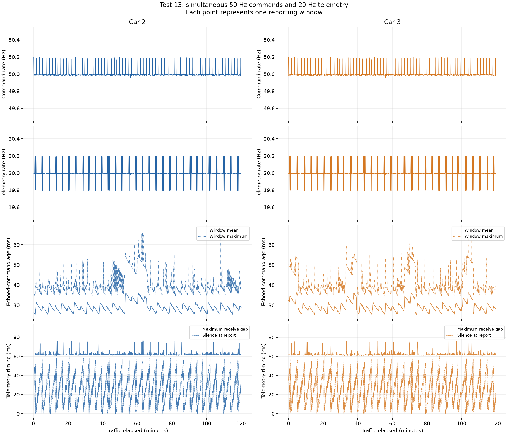
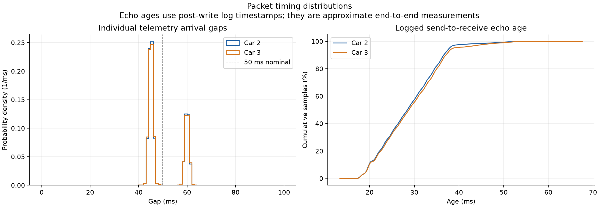

# Test 13 endurance analysis

Run: 2026-10-12 00:01:40 to 2026-10-12 02:01:48 Hong Kong time.

Traffic duration: **7200.008 seconds**. Runner result: **passed**.

| Metric | Car 2 | Car 3 |
|---|---:|---:|
| Commands received by car | 360,000 | 360,000 |
| Notifications received | 144,003 | 144,003 |
| Command rate (Hz) | 49.999998 | 49.999998 |
| Telemetry rate (Hz) | 20.000416 | 20.000416 |
| Command sequence gaps | 0 | 0 |
| Telemetry sequence gaps | 0 | 0 |
| Mean echoed-command age (ms) | 28.83 | 29.29 |
| Maximum echoed-command age (ms) | 67.75 | 67.81 |
| Maximum telemetry gap (ms) | 89.58 | 89.78 |

## Delivery and stability

Python's 360,000 world records reconcile with the CSV, modem
serial/per-link counters and each car's independently monitored receive totals.
Notification counts and sequence continuity were rechecked directly from raw
21-byte packets. Sequence loss counts application gaps, not radio retransmissions.

Raw command sequence wraparounds: 6. Command pacing overruns: 0.

Modem gap/error/drop counters did not increase. Both links had no reconnects
during traffic and one intentional disconnect at shutdown.

- Car 2: 2 notification sequence wraparounds;
  gap median / p95 / p99 = 45.59 / 60.88 / 61.55 ms.
  Gaps >=100 ms: 0; >=200 ms: 0.
  Logged echo-age median / p95 / p99 = 28.46 / 37.85 / 48.23 ms.
  Car heap range: 252,032–252,072 bytes; observed uptime resets: 0.
  Quarter-run mean echo ages: 28.27 ms, 29.44 ms, 29.30 ms, 28.31 ms.
- Car 3: 2 notification sequence wraparounds;
  gap median / p95 / p99 = 45.60 / 60.90 / 61.58 ms.
  Gaps >=100 ms: 0; >=200 ms: 0.
  Logged echo-age median / p95 / p99 = 28.80 / 38.70 / 50.26 ms.
  Car heap range: 252,004–252,044 bytes; observed uptime resets: 0.
  Quarter-run mean echo ages: 29.07 ms, 29.39 ms, 29.34 ms, 29.39 ms.

Independent check failures: none.

## Interpretation and measurement limits

The two-link setup sustained the target throughput over this observation.
Quarter-run mean echo ages range from 28.27 to 29.44 ms.
Their chronological values above show whether delay accumulated.
The timing plots show individual arrivals rather than assuming a perfectly
uniform nominal interval. Counts such as 99/100/101 in five-second windows
can be timing/boundary variation when sequences remain contiguous.

The mean/maximum echo ages in the table are the runner's timestamped
measurements from before serial writes. Packet percentiles are reconstructed
from raw post-write send and receive log timestamps, so they differ slightly
and must be treated as approximations. Both include USB transport, modem
scheduling, BLE and car notification timing. Neither measures pure RF RTT.

Server silence is sampled at five-second report times, not the worst gap
between every world command. Exact matching final command totals strengthen
the receive-rate result. Two-car synthetic traffic does not validate four-car
capacity, motor response or disconnect safety behavior.

Intentional final `#STOP` disconnects are outside traffic. The recorded final
modem state is disabled with zero links, and both cars resume advertising.

## Sources and plots

[Summary](ble_test_13_20261011_160140_109793.summary.json), [CSV](ble_test_13_20261011_160140_109793.csv), raw JSONL (local-only `ble_test_13_20261011_160140_109793.jsonl`), [manifest](manifest.json).

