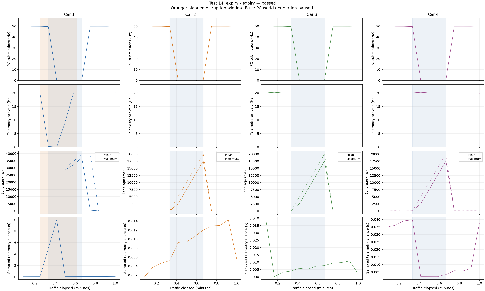

# Test 14: expiry

Result: **passed**. Traffic duration: 60.002 seconds.

| Car | Notifications | Inferred telemetry gaps | Ambiguous sequence changes | Largest arrival gap (s) | Largest matched echo age (ms) |
|---|---:|---:|---:|---:|---:|
| 1 | 947 | 0 | 0 | 12.699 | 39693.2 |
| 2 | 1,200 | 0 | 0 | 0.067 | 20015.6 |
| 3 | 1,201 | 0 | 0 | 0.081 | 20020.0 |
| 4 | 1,200 | 0 | 0 | 0.118 | 20024.2 |

Validation failures: none.

PC submissions count successful serial writes, not car receipts. Attached car serial counters independently check receipts during bench tests.

Sequence gaps are application observations, including intentional snapshot supersession. Without session metadata, some reset/replacement/wrap cases remain ambiguous.

Echo age includes USB, modem scheduling, BLE and notification timing. It is not pure radio RTT. During intentional idle periods the retained world naturally becomes old; this does not imply a connection failure.

A returning car reports zero before its first WorldState. In older logger captures, that zero may match the real sequence zero sent near startup and produce misleading 30–40 second ages. Such initial zero echoes are unconfirmed, not measured transaction times. The current logger suppresses them after a possible restart/outage until a nonzero echo arrives. The car serial audit independently confirms that no expired world was applied.

[CSV](ble_test_14_20261012_163740_003868.csv), [summary](ble_test_14_20261012_163740_003868.summary.json), [manifest](manifest.json).

