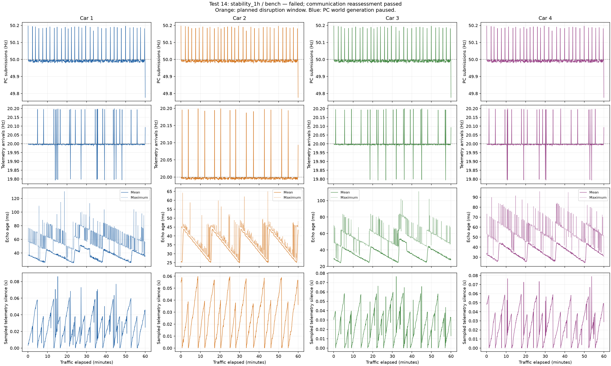

# Test 14: stability_1h

Result: **failed**. Traffic duration: 3600.001 seconds.

| Car | Notifications | Inferred telemetry gaps | Ambiguous sequence changes | Largest arrival gap (s) | Largest matched echo age (ms) |
|---|---:|---:|---:|---:|---:|
| 1 | 72,001 | 0 | 0 | 0.160 | 130.4 |
| 2 | 72,002 | 0 | 0 | 0.101 | 65.0 |
| 3 | 72,002 | 0 | 0 | 0.120 | 111.2 |
| 4 | 72,002 | 0 | 0 | 0.121 | 95.8 |

Validation failures: Car 1: unexpected reconnect.

Independent startup reassessment: **passed**. The original result remains unchanged. The old runner used a disconnected pre-traffic car serial snapshot as a connection-count baseline, incorrectly calling completion of startup an unexpected reconnect. Retained receive totals, disconnect counts and all traffic-time connection observations are checked separately. See [reassessment](startup_reassessment.json). The current runner waits for connected/subscribed car serial baselines before sending worlds.

PC submissions count successful serial writes, not car receipts. Attached car serial counters independently check receipts during bench tests.

Sequence gaps are application observations, including intentional snapshot supersession. Without session metadata, some reset/replacement/wrap cases remain ambiguous.

Echo age includes USB, modem scheduling, BLE and notification timing. It is not pure radio RTT. During intentional idle periods the retained world naturally becomes old; this does not imply a connection failure.

[CSV](ble_test_14_20261012_164508_507394.csv), [summary](ble_test_14_20261012_164508_507394.summary.json), [manifest](manifest.json).

